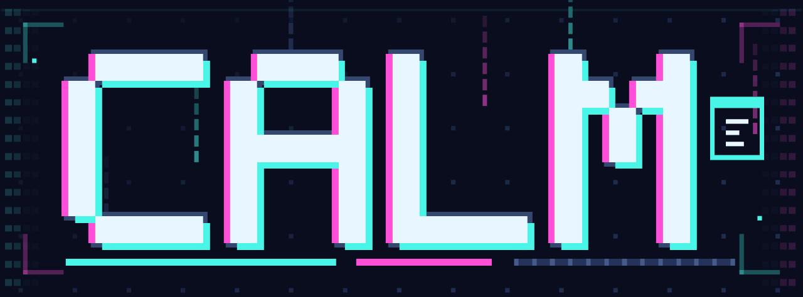
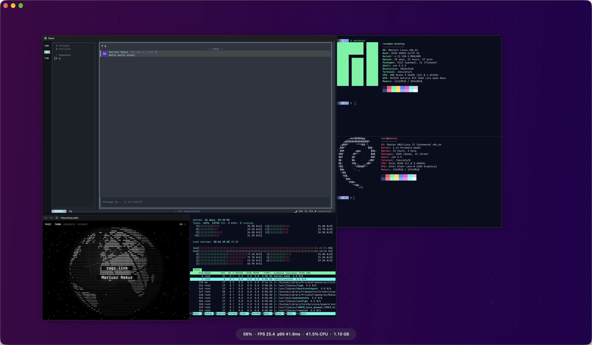

**One pan and zoom canvas on macOS. Ghostty terminals, a live browser and your own plugins
side by side, all of them still running while you move around. A plugin SDK lets you shape
it into whatever workspace you need.**

**[calm.raqz.link](https://calm.raqz.link)** · [Docs](#documentation) · [Plugins](https://calm.raqz.link/plugins/)


> [!WARNING]
> CALM is an early prototype and nothing has been released yet. The first release candidate
> of the alpha is planned for the first weeks of November 2026, as a `.dmg` image or through
> Homebrew. Until then you build it from source.



# CALM

## Why CALM

Stacked windows and tabs hide each other. A canvas does not. Draw a rectangle and you get a
real Ghostty terminal or a web browser in it. Arrange panels like notes on a whiteboard, zoom
out to see the whole workspace, zoom in to work.

Every panel keeps running while you pan, zoom or minimize it. Only an explicit, confirmed
close ends it. Zooming scales the view and never the terminal, so rows and columns stay put.
Panels dropped edge to edge join into one block with a single divider. Distant panels become
still previews refreshed every two seconds, which is what keeps twenty live terminals cheap
to paint.

## Built to be extended

CALM is a small core with a plugin SDK on top. What the canvas does not do yet, a plugin can
add. The welcome page, the key bindings page and the GitHub PRs panel are plugins built the
same way yours would be.

- **A plugin is a folder.** A `calm-plugin.json` manifest and an HTML page. No build step,
  or TSX built with bun if you want types and components.
- **A real host API.** `window.calm` gives a plugin 18 calls into CALM: its own settings and
  storage, its panel (title, bounds, minimize, close), the canvas (open, focus and list
  panels), `process.exec`, `gh api` without ever seeing a token, the theme and the key
  bindings.
- **Hooks into the app.** `contributes.menus` adds items to the right-click menus on the
  canvas or on panels. The chosen item reaches the plugin as a `command` event.
- **Any terminal program becomes a panel.** A TUI manifest names a command and, if you like,
  its title, icon, size, title bar colors, terminal palette and restart behavior. No HTML.
- **Typed and MIT licensed.** [`packages/calm-plugin-sdk`](packages/calm-plugin-sdk/README.md)
  holds the TypeScript types for `window.calm`, and [`templates/`](templates/) has TSX and
  TUI starters. Both are MIT, so your plugin can use any license.
- **The rest is settings.** Backgrounds, grid, snapping, terminal profiles and every key
  binding change live in Settings, and presets save whole layouts.

Today the host delivers the `command` event; the other plugin events and the v2 API are
designed but not built. Plugins run as trusted code. See [Plugins](#plugins) and
[docs/plugins.md](docs/plugins.md).

## Highlights

- **Terminals.** Live Ghostty surfaces, as many as you like, at any size. Use your own Ghostty
  config, or named profiles with their own colors, command and start folder.
- **Browser.** Real web pages in a panel, with an address bar, back, forward and reload. Type
  a host and it opens, type anything else and it searches.
- **TUI apps.** One manifest turns a terminal program into an Add menu entry, so a tool like
  `htop` or a Slack client lands on the canvas as a panel instead of a window.
- **Plugins.** Your own panels in HTML and JavaScript (TSX optional), with a typed SDK, 18
  host calls through `window.calm` and items in the right-click menus.
- **Make it yours.** Backgrounds, grid, snapping, terminal colors and every key binding are
  settings, changed live in a native Settings window.
- **Picks up where you left off.** A launch restores the last session (panels, order and
  camera, with fresh processes) and autosaves it as you work. `--no-restore` starts empty.
  The first launch opens the `welcome` preset. File > Save Preset… and Load Preset… keep
  named layouts, and Developer > Show Welcome Screen brings the welcome page back.

<details>
<summary>All features</summary>

### Canvas

- Pan and zoom without limits: pinch, `cmd` and scroll, or the keyboard.
- Zooming scales the view, never the terminal. Rows and columns stay the same.
- Center on the world origin (`cmd-shift-h`) or fit every panel on screen (Cmd+Shift+0),
  both also in the View menu.
- Distant panels turn into still previews that refresh every 2 seconds.
- A translucent status pill at the bottom shows zoom, plugin errors and warnings, and on
  `cmd-shift-f` FPS, CPU and memory.
- TUI apps: a plugin folder with one manifest turns a terminal program into an Add menu entry,
  for example "Slack" running `slk`. It runs through your login shell, shows when it exited and
  can restart.
- Grid styles: lines, dots, crosses or none, with an optional major grid.
- Fullscreen mode.

### Panels

- Live Ghostty terminals, optionally using your own Ghostty config.
- Add > Run Command… opens a terminal running one command, say `htop`, and restarts it when
  it exits according to `terminal.command_restart`.
- `cmd`-drag on a terminal's or page's content moves the panel; a `cmd`-click still reaches
  the content (`canvas.move_modifier`).
- Terminal defaults and named profiles: title, icon, chrome colors, Ghostty colors, command,
  arguments, start folder and environment. Color changes recolor running terminals in place.
  Profiles show under Add > Terminal Profiles.
- See-through terminals: `content_opacity` from 0.2 to 1 fades a terminal's text and
  background while its title bar stays solid.
- Move and resize with snapping to an 8 unit grid and to nearby panel edges. Browser and
  plugin panels resize from just outside their right and bottom edges.
- Panels placed edge to edge join into one block with a single divider.
- Title bars with a kind icon, focus ring and hover buttons for minimize and close.
- Right-click a title bar for Minimize or Restore, Zoom to Fit, Bring to Front, Send to Back,
  Duplicate (terminals) and Delete.
- Closing a running terminal or a browser asks first. This can be turned off.
- A click on empty canvas, left or right, drops panel focus: the focus ring goes and typing
  goes back to the canvas. Pans and zooms keep focus. Off with
  `canvas.click_empty_clears_focus=false` (Settings, Canvas and Snapping).

### Browser

- Live web pages in a panel, with an address bar, back, forward and reload.
- Type a URL or a host, or anything else to search DuckDuckGo.
- Links and `target=_blank` open in the same panel.
- `cmd-[` back, `cmd-]` forward, `cmd-r` reload, `cmd-l` address bar.

### Plugins

- Installed plugins appear in the right-click Add menu and open as canvas panels. A manifest
  with `"addMenu": false` stays out of Add; presets and sessions still open it.
- Plugins are HTML and JavaScript, or TSX built with bun, talking to CALM through
  `window.calm`.
- First-party plugins (Hello World, GitHub PRs, a `top` TUI example) load without install, as
  do the welcome and key bindings pages that the `welcome` preset opens.
- Plugins can add items to the right-click menus.
- `calm.github.api` runs `gh api` on the host; plugin code never sees a token.
- Rejected calls carry a `code`, and `calm.has(method)` says what this CALM serves.
- Broken plugin folders are skipped and reported in the status pill.

### Customization

- A native Settings window (`cmd-,`) with Background, Grid, Canvas and Snapping, Panels,
  Terminal, Session and Developer sections. Session controls restore at launch and
  autosave.
- Backgrounds: solid color, linear or radial gradients with 2 to 6 stops, or an image with
  cover, contain, tile or center.
- Image filters: blur, brightness, contrast, saturation, grayscale and dim.
- Grid spacing, color and opacity. Snapping on or off, grid step and edge distance.
- Changes show live on the canvas and persist to `settings.json`.

</details>

## Who it is for

CALM suits you if you keep many terminals, a browser and a few small tools open at once and
want to see them all in one place, laid out the way you think about the work.

It is the wrong tool if you want:

- a tabbed terminal, because CALM is one canvas instead
- a sandbox for untrusted plugins, because plugins run as trusted code
- a shipped download today, because there is no release yet

## Get started

You need macOS 14 or newer on Apple Silicon (arm64). To build: Rust 1.95 or newer, Zig 0.16,
the Xcode command line tools with the Metal Toolchain, GNU Make 4 (`gmake`), `gh` and `bun`.

```sh
git clone https://github.com/kolezka/CALM.git
cd CALM
gmake setup-check                 # checks the toolchain
cargo run --release -p calm-app   # add -- --fullscreen to start fullscreen
```

[docs/dev-setup.md](docs/dev-setup.md) lists every prerequisite and how to install it.
Releases will ship as a `.dmg` or through Homebrew. The app is ad-hoc signed, not notarized,
so on first launch right-click it and pick Open. See [docs/release.md](docs/release.md).

### First keys

| Action                | How                                    |
| --------------------- | -------------------------------------- |
| Draw a terminal       | `t`, then drag on the canvas           |
| Draw a browser        | `b`, then drag on the canvas           |
| Add a panel or plugin | Right-click empty canvas               |
| Pan                   | Space and drag, middle-drag, scroll    |
| Zoom                  | Pinch, or `cmd` and scroll             |
| Fit all panels        | Cmd+Shift+0                            |
| Delete focused panel  | `cmd-shift-backspace` (confirms a live one) |
| Settings              | `cmd-,`                                |

Every key is a default; change any of them in Settings > Keys.

<details>
<summary>All keys</summary>

| Action                          | How                                       |
| ------------------------------- | ----------------------------------------- |
| Draw a terminal                 | `t`, then drag on the canvas              |
| Draw a browser                  | `b`, then drag on the canvas              |
| Cancel drawing                  | `Esc`                                     |
| Add a panel or plugin           | Right-click empty canvas                  |
| Panel actions                   | Right-click a title bar                   |
| Run a command in a terminal     | Right-click > Add > Run Command…          |
| Move a panel by its content     | `cmd`-drag on a terminal or page          |
| Panel menu from its content     | `cmd`-right-click on a terminal or page   |
| Delete focused panel            | `cmd-shift-backspace` (confirms a live one) |
| Focused panel Settings          | `cmd-shift-,`                             |
| Pan                             | Space and drag, middle-drag, scroll       |
| Pan in steps                    | Arrow keys when no panel has the keyboard, Shift for bigger steps |
| Move the focused panel          | `cmd-option` and arrows, Shift for bigger steps |
| Zoom                            | Pinch, or `cmd` and scroll                |
| Zoom in, out, reset             | `cmd-=`, `cmd--`, `cmd-0`                 |
| Center on origin                | `cmd-shift-h`                             |
| Fit all panels                  | Cmd+Shift+0 (stored as `cmd-)`)           |
| Move or resize without snapping | Hold `cmd-shift` while dragging           |
| Settings                        | `cmd-,`                                   |
| Fullscreen                      | `cmd-ctrl-f`                              |
| Show FPS, CPU and memory        | `cmd-shift-f`                             |

Scrolling over empty canvas pans it. Scrolling over a terminal scrolls the terminal.

</details>

## Plugins

A plugin is a folder with a `calm-plugin.json` manifest and an HTML entry page. CALM finds it
at startup, lists it in the Add menu (unless its manifest sets `"addMenu": false`) and runs
it in a panel. Plugins are trusted code that you install yourself, with full access, so only
install plugins you have read or whose author you trust.

The host answers all 18 bridge methods of the v1 API, including opening, focusing and listing
panels and `process.exec`. Of the plugin events, only `command` is delivered today. From the
v2 API, error codes and `calm.has` are built; the rest (events, camera, terminal and browser
control, plugin backends) is design only.

From a clone, `gmake plugins && cargo run -p calm-app` builds the first-party plugins and shows
them under right-click > Add. The welcome page (`calm-welcome`) and the key bindings page
(`calm-keys`) set `addMenu: false`, so they are not in Add; the `welcome` preset opens them.
A development build reads the repository's `plugins/` folder directly; installed plugins go in
`~/.config/calm/plugins`. Set `CALM_NO_BUILTIN_PLUGINS=1` to hide the built-in ones.

A TUI app plugin needs no HTML: its manifest names a command, and CALM runs it in a terminal
panel. See "TUI apps" in [docs/plugins.md](docs/plugins.md#tui-apps) and
[templates/plugin-tui](templates/plugin-tui/README.md).

```json
{
  "id": "hello-world",
  "name": "Hello World",
  "version": "0.1.0",
  "entry": "index.html",
  "defaultSize": { "width": 320, "height": 200 }
}
```

Read [docs/plugins.md](docs/plugins.md) for the manifest and the `window.calm` API, and start
from the TSX template in [templates/plugin-tsx](templates/plugin-tsx/README.md).

## Configuration

- Settings live in `~/.config/calm/settings.json`. Terminal defaults and profiles, the
  stats readout, focus on click and the session fields are described in
  [docs/configuration.md](docs/configuration.md).
- `CALM_HOME` replaces `~/.config/calm` for settings, plugins, plugin data and `.env`.
- `CALM_PLUGIN_PATH` adds plugin folders, `:` separated like `PATH`. For development:
  `CALM_PLUGIN_PATH=./plugins cargo run -p calm-app`.
- Without it, plugins load from `$CALM_HOME/plugins` or `~/.config/calm/plugins`.
- GitHub access for plugins goes through `gh`. Either run `gh auth login`, or put
  `GITHUB_TOKEN=<your token>` in `~/.config/calm/.env` (`chmod 600` it). Order:
  `GH_TOKEN` or `GITHUB_TOKEN` in CALM's environment, then `$CALM_HOME/.env`, then in dev
  builds the checkout's `.env`, then `gh`'s own login. Plugin code never sees the token.
  Details in [docs/plugins.md](docs/plugins.md#github-access).

## Project status

CALM is an early prototype. Nothing has been released and the GUI has had limited manual
testing.

Session restore, autosave and named presets (File > Save Preset… and Load Preset…) work.
Not built yet: the `ask` restore dialog, a benchmark mode, and most of the plugin API v2
(all 18 v1 bridge methods answer).

## Documentation

- [Developer setup](docs/dev-setup.md): prerequisites, running, tests, make targets.
- [Architecture](docs/architecture.md): terminals, native views and previews.
- [Configuration](docs/configuration.md): `settings.json`, terminal defaults and profiles.
- [Plugins](docs/plugins.md): manifest, `window.calm` API and the trust model.
- [Releases and CI](docs/release.md): CI jobs, cutting a release, the macOS bundle.
- [Design spec](docs/superpowers/specs/2026-10-31-calm-design.md) and
  [prototype plan](docs/superpowers/plans/2026-10-31-calm-prototype.md).
- [Plugin API v2 design](docs/superpowers/specs/2026-10-31-plugin-api-v2-design.md)
  (phase 1, error codes and `calm.has`, is built; the rest is design).
- [Canvas persistence plan](docs/superpowers/plans/2026-10-31-canvas-persistence.md)
  (Tasks 1 to 5 merged: storage, autosave and restore at launch).
- [Claude Code mods integration](docs/superpowers/specs/2026-10-31-claude-code-mods-integration.md)
  (research).

## Contributing

Set up with [docs/dev-setup.md](docs/dev-setup.md). Work on a branch, run
`cargo test -p <crate>` while iterating, and pass `gmake ci` (clippy, fmt, tests, smoke and
plugin type checks) before opening a pull request.

## License

Copyright (c) 2026 Mariusz Rakus. All rights reserved. CALM is proprietary software; see
[LICENSE](LICENSE). The plugin SDK (`packages/calm-plugin-sdk`) and the plugin templates
(`templates/`) are MIT licensed, so plugins built from them can use any license.
