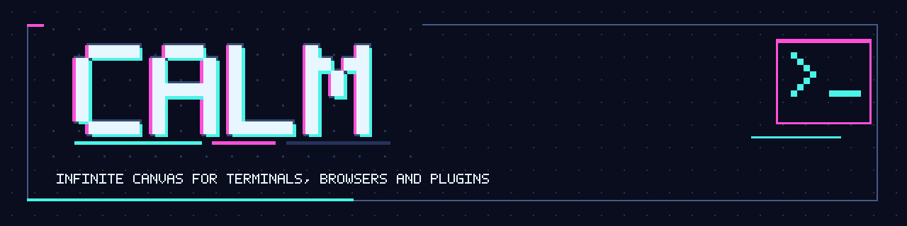

# CALM

An infinite pan and zoom canvas for macOS that hosts live terminals, browsers and plugins
side by side.


## What is CALM

CALM replaces a stack of windows and tabs with one large canvas. Draw a rectangle and you get
a real Ghostty terminal or a web browser in it. Arrange panels like notes on a whiteboard,
zoom out to see the whole workspace, zoom in to work. Every panel keeps running while you
pan, zoom or minimize it. Only an explicit, confirmed close ends it.

## Features

### Canvas

- Pan and zoom without limits: pinch, `cmd` and scroll, or the keyboard.
- Zooming scales the view, never the terminal. Rows and columns stay the same.
- Center on the world origin (`cmd-shift-h`) or fit every panel on screen (`cmd-shift-0`),
  both also in the View menu.
- Distant panels turn into still previews that refresh every 2 seconds.
- A translucent status pill at the bottom shows zoom, plugin errors and warnings, and on
  `cmd-shift-f` FPS, CPU and memory.
- TUI apps: a plugin folder with one manifest turns a terminal program into an Add menu entry,
  for example "Slack" running `slk`. It runs through your login shell, shows when it exited and
  can restart.
- Grid styles: lines, dots, crosses or none, with an optional major grid.
- Fullscreen mode.

### Panels

- Live Ghostty terminals, optionally using your own Ghostty config.
- Terminal defaults and named profiles: title, icon, chrome colors, Ghostty colors, command,
  arguments, start folder and environment. Color changes recolor running terminals in place.
  Profiles show under Add > Terminal Profiles.
- Move and resize with snapping to an 8 unit grid and to nearby panel edges. Browser and
  plugin panels resize from just outside their right and bottom edges.
- Panels placed edge to edge join into one block with a single divider.
- Title bars with a kind icon, focus ring and hover buttons for minimize and close.
- Right-click a title bar for Minimize or Restore, Zoom to Fit, Bring to Front, Send to Back,
  Duplicate (terminals) and Delete.
- Closing a running terminal or a browser asks first. This can be turned off.
- A click on empty canvas, left or right, drops panel focus: the focus ring goes and typing
  goes back to the canvas. Pans and zooms keep focus. Off with
  `canvas.click_empty_clears_focus=false` (Settings, Canvas and Snapping).

### Browser

- Live web pages in a panel, with an address bar, back, forward and reload.
- Type a URL or a host, or anything else to search DuckDuckGo.
- Links and `target=_blank` open in the same panel.
- `cmd-[` back, `cmd-]` forward, `cmd-r` reload, `cmd-l` address bar.

### Plugins

- Installed plugins appear in the right-click Add menu and open as canvas panels.
- Plugins are HTML and JavaScript, or TSX built with bun, talking to CALM through
  `window.calm`.
- First-party plugins (Hello World, GitHub PRs, a `top` TUI example) load without install.
- Plugins can add items to the right-click menus.
- `calm.github.api` runs `gh api` on the host; plugin code never sees a token.
- Rejected calls carry a `code`, and `calm.has(method)` says what this CALM serves.
- Broken plugin folders are skipped and reported in the status pill.

### Customization

- A native Settings window (`cmd-,`) with Background, Grid, Canvas and Snapping, Panels,
  Terminal, Session and Developer sections. The Session settings have no effect yet.
- Backgrounds: solid color, linear or radial gradients with 2 to 6 stops, or an image with
  cover, contain, tile or center.
- Image filters: blur, brightness, contrast, saturation, grayscale and dim.
- Grid spacing, color and opacity. Snapping on or off, grid step and edge distance.
- Changes show live on the canvas and persist to `settings.json`.

## Requirements

- macOS 14 or newer on Apple Silicon (arm64).
- To build: Rust 1.95 or newer, Zig 0.16, the Xcode command line tools with the Metal
  Toolchain, GNU Make 4 (`gmake`), `gh` and `bun`.

## Install

No release has been published yet. Build from source:

```sh
git clone https://github.com/kolezka/CALM.git
cd CALM
gmake setup-check                 # checks the toolchain
cargo run --release -p calm-app   # add -- --fullscreen to start fullscreen
```

[docs/dev-setup.md](docs/dev-setup.md) lists every prerequisite and how to install it.
Future releases will ship a macOS zip. The app is ad-hoc signed, not notarized, so on first
launch right-click it and pick Open. See [docs/release.md](docs/release.md).

## Usage

| Action                          | How                                       |
| ------------------------------- | ----------------------------------------- |
| Draw a terminal                 | `t`, then drag on the canvas              |
| Draw a browser                  | `b`, then drag on the canvas              |
| Cancel drawing                  | `Esc`                                     |
| Add a panel or plugin           | Right-click empty canvas                  |
| Panel actions                   | Right-click a title bar                   |
| Pan                             | Space and drag, middle-drag, scroll       |
| Zoom                            | Pinch, or `cmd` and scroll                |
| Zoom in, out, reset             | `cmd-=`, `cmd--`, `cmd-0`                 |
| Center on origin                | `cmd-shift-h`                             |
| Fit all panels                  | `cmd-shift-0`                             |
| Move or resize without snapping | Hold `alt` while dragging                 |
| Settings                        | `cmd-,`                                   |
| Fullscreen                      | `cmd-ctrl-f`                              |
| Show FPS, CPU and memory        | `cmd-shift-f`                             |

Scrolling over empty canvas pans it. Scrolling over a terminal scrolls the terminal.

## Plugins

A plugin is a folder with a `calm-plugin.json` manifest and an HTML entry page. CALM finds it
at startup, lists it in the Add menu and runs it in a panel. Plugins are trusted code that you
install yourself, with full access, so only install plugins you have read or whose author you
trust. The bridge is partial today: `log`, `panel.setTitle`, `settings.get`, `settings.set`,
`storage.get`, `storage.set`, `storage.remove`, `github.api` and `openExternal` answer; the
other methods reject with code `not_implemented`.

From a clone, `gmake plugins && cargo run -p calm-app` builds the first-party plugins and shows
them under right-click > Add. A development build reads the repository's `plugins/` folder
directly; installed plugins go in `~/.config/calm/plugins`. Set `CALM_NO_BUILTIN_PLUGINS=1` to
hide the built-in ones.

A TUI app plugin needs no HTML: its manifest names a command, and CALM runs it in a terminal
panel. See "TUI apps" in [docs/plugins.md](docs/plugins.md#tui-apps) and
`templates/plugin-tui`.

```json
{
  "id": "hello-world",
  "name": "Hello World",
  "version": "0.1.0",
  "entry": "index.html",
  "defaultSize": { "width": 320, "height": 200 }
}
```

Read [docs/plugins.md](docs/plugins.md) for the manifest and the `window.calm` API, and start
from the TSX template in [templates/plugin-tsx](templates/plugin-tsx/README.md).

## Configuration

- Settings live in `~/.config/calm/settings.json`. Terminal defaults and profiles, the
  stats readout, focus on click and the session fields are described in
  [docs/configuration.md](docs/configuration.md).
- `CALM_HOME` replaces `~/.config/calm` for settings, plugins, plugin data and `.env`.
- `CALM_PLUGIN_PATH` adds plugin folders, `:` separated like `PATH`. For development:
  `CALM_PLUGIN_PATH=./plugins cargo run -p calm-app`.
- Without it, plugins load from `$CALM_HOME/plugins` or `~/.config/calm/plugins`.
- GitHub access for plugins goes through `gh`. Either run `gh auth login`, or put
  `GITHUB_TOKEN=<your token>` in `~/.config/calm/.env` (`chmod 600` it). Order:
  `GH_TOKEN` or `GITHUB_TOKEN` in CALM's environment, then `$CALM_HOME/.env`, then in dev
  builds the checkout's `.env`, then `gh`'s own login. Details in
  [docs/plugins.md](docs/plugins.md#github-access).

## Project status

CALM is an early prototype. Nothing has been released and the GUI has had limited manual
testing.

Not built yet: saving and restoring layouts or sessions (the file format and safe write
code exist, nothing uses them yet, so every launch starts empty), a benchmark mode, and
about half of the plugin bridge.

## Documentation

- [Developer setup](docs/dev-setup.md): prerequisites, running, tests, make targets.
- [Architecture](docs/architecture.md): terminals, native views and previews.
- [Configuration](docs/configuration.md): `settings.json`, terminal defaults and profiles.
- [Plugins](docs/plugins.md): manifest, `window.calm` API and the trust model.
- [Releases and CI](docs/release.md): CI jobs, cutting a release, the macOS bundle.
- [Design spec](docs/superpowers/specs/2026-10-31-calm-design.md) and
  [prototype plan](docs/superpowers/plans/2026-10-31-calm-prototype.md).
- [Plugin API v2 design](docs/superpowers/specs/2026-10-31-plugin-api-v2-design.md)
  (phase 1 built, the rest is design).
- [Canvas persistence plan](docs/superpowers/plans/2026-10-31-canvas-persistence.md)
  (Tasks 1 to 3 merged, autosave and restore not built).
- [Claude Code mods integration](docs/superpowers/specs/2026-10-31-claude-code-mods-integration.md)
  (research).

## Contributing

Set up with [docs/dev-setup.md](docs/dev-setup.md). Work on a branch, run
`cargo test -p <crate>` while iterating, and pass `gmake ci` (clippy, fmt, tests, smoke and
plugin type checks) before opening a pull request.
